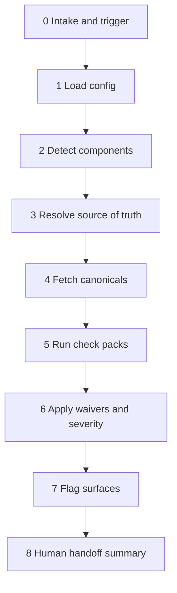

# Design System Governance

Follow this pipeline **in order** for every governance run. At **each stage**, perform the **drift checks** listed before advancing. Do not skip stages unless the user explicitly requests a scoped audit (name the stage and what was skipped).

## Pipeline diagram



Detailed drift definitions: [pipeline-and-drift.md](pipeline-and-drift.md)

---

## Stage 0 — Intake and trigger

**Goal:** Know who contributed, what changed, and which command or CI job to mirror.

| Path | Trigger | Command / event |
|------|---------|-----------------|
| Engineer | PR or local code | `ds-gov run` or GitHub `pull_request` workflow |
| Designer | Figma-linked component | `ds-gov designer --component <id>` |
| Maintainer | Full audit | `workflow_dispatch` or `ds-gov run` on repo root |

**Drift checks (stage 0):**

- [ ] **Trigger drift** — Is the run using the right entry path? (Designer work reviewed only via `run` on code may miss Figma-only discrepancies.)
- [ ] **Scope drift** — Does the contribution include both Figma and code while only one path was triggered? If yes, run **both** paths or `dual_compare` with snapshots/API.
- [ ] **Ref drift** — For engineers, confirm `--base` / PR base is the owner’s canonical ref (usually `main`). For designers, confirm `figma-file-key` / branch matches the file they edited.

---

## Stage 1 — Load configuration

**Goal:** Read owner policy before interpreting findings.

1. Load `governance-profile.yaml` (or `governance-profile.example.yaml` in this repo).
2. Load `component-registry.yaml`.
3. If present, load `.ds-governance-waivers.yaml`.

**Drift checks (stage 1):**

- [ ] **Config drift** — Profile and registry disagree (e.g. component in registry but no `severity_policy` for its categories). Flag `info` and cite missing policy keys.
- [ ] **Registry drift** — Component touched in diff but **not** in registry → treat as `auto_register: suggest`; list required fields (`code.paths`, `figma.component_set_node_id`, `owners`).
- [ ] **Stale waiver drift** — Waivers past `expires_at` still in file → report as expired; findings should not be suppressed.

---

## Stage 2 — Detect components

**Goal:** Map changed files → registry component IDs (all components use the same logic).

1. List changed paths (PR diff, `--head` folder, or designer `--component` filter).
2. Match against `source_of_truth.code.paths` / `code.paths` in registry.
3. Resolve `check_packs` per component (e.g. `default_primitive`).

**Drift checks (stage 2):**

- [ ] **Detection drift** — Files match multiple components or none → list ambiguous paths and ask owner to tighten globs.
- [ ] **Dependency drift** — Composite change uses child components (e.g. `ButtonGroup` + `Button`) but only parent detected → also run checks for declared `dependencies` if present in registry.
- [ ] **Unscoped drift** — Changes under `tokens/**` with no component → run token rules globally; note affected components via token manifest if available.

---

## Stage 3 — Resolve source of truth

**Goal:** Per component, apply `source_of_truth.mode` and `on_conflict` from profile/registry.

| Mode | Canonical for comparison |
|------|---------------------------|
| `code` | Code on `ref` (default `main`) |
| `figma` | Figma library / branch + variables |
| `dual_compare` | Both; mismatches are **platform drift** |

**Drift checks (stage 3):**

- [ ] **SoT drift** — Wrong mode for change type (token release should usually be `code`-led; variant matrix often `figma`-led). Note in handoff if policy may be wrong, not only contributor.
- [ ] **Conflict policy drift** — `on_conflict: flag_owner` vs `code_wins` / `figma_wins` — ensure findings text states which side is treated as expected for **this** category (see `token_truth` / visual split in profile if defined).
- [ ] **Branch drift** — Designer on Figma branch but canonical code is `main` → expected for WIP; label findings `figma_ahead` vs `code_ahead` in the message when helpful.

---

## Stage 4 — Fetch canonicals

**Goal:** Build comparable snapshots for each component.

**Code:** PR head or `--head` path; canonical baseline from `main` or `.ds-governance/snapshots/{Component}.code.json`.

**Figma:** `.ds-governance/snapshots/{Component}.figma.json` and/or Figma API (`file_key`, `component_set_node_id`, branch key). Use MCP `get_design_context` / `get_variable_defs` when token is available; comments via REST only (`FIGMA_ACCESS_TOKEN`).

**Drift checks (stage 4):**

- [ ] **Snapshot drift** — Missing `.figma.json` or `.code.json` while `dual_compare` is on → `info` finding `DS-SOT-MISSING`; do not silently pass parity.
- [ ] **Version drift** — Record in report: code SHA/ref and Figma file version/branch used (`comparedAgainst` in CLI output).
- [ ] **Stale canonical drift** — Snapshots older than last `main` release or Figma publish → warn `canonical_may_be_stale` if dates/versions are known.

---

## Stage 5 — Run check packs

**Goal:** Execute checks for each component. Default pack: `tokens`, `duplicates`, `figma_code`.

Run via CLI (preferred):

```bash
npm ci && npm run build

# Engineer
npm run ds-gov -- run -p governance-profile.yaml -r component-registry.yaml --head <path> --format json

# Designer
npm run ds-gov -- designer -p governance-profile.yaml -r component-registry.yaml -c <ComponentId> --figma-file-key <key>
```

**Per-check drift audit (stage 5 — complete every row for each affected component):**

| Check | Drift type | What to verify | Category id |
|-------|------------|----------------|-------------|
| Tokens | **Token drift** | No raw hex/rgb; only allowed vars; deprecated token names | `token_consistency` |
| Tokens | **Tier drift** | Primitives on product surfaces when policy requires semantic only | `token_consistency` |
| Duplicates | **Duplicate drift** | Parallel Button-like implementations; overlapping APIs | `duplicate_candidate` |
| Figma/code | **Design–code drift** | Variables/bindings vs code manifest / snapshots | `figma_code_mismatch` |
| Figma/code | **Variant drift** | Missing states (hover, focus, disabled) Figma vs code | `figma_code_mismatch` |
| Consumers | **Adoption drift** | Local overrides, forked components in apps (when consumer scan enabled) | `consumer_drift` |
| API | **API drift** | Breaking prop changes vs `main` without migration | `api_breaking` |
| Docs | **Documentation drift** | Storybook/props vs types; Figma vs Code Connect | `docs_gap` |

If not running CLI, manually grep for `#[0-9a-fA-F]{3,8}`, compare registry paths, and read snapshot JSON under `.ds-governance/snapshots/`.

**Drift checks (stage 5 exit):**

- [ ] Every finding has `id`, `severity`, `category`, `component`, and `location` or Figma `node_id`.
- [ ] **Regression drift** — Contribution widens an existing Figma/code gap (flag separately from pre-existing platform drift when both snapshots exist).
- [ ] **Cross-component drift** — Token change on `Button` breaks `ButtonGroup` semantic bindings → note in summary even if only one component was detected.

---

## Stage 6 — Apply waivers and severity

**Goal:** Map categories through `severity_policy`; apply `.ds-governance-waivers.yaml`.

**Drift checks (stage 6):**

- [ ] **Severity drift** — Finding category not in `severity_policy` → default to `warn` and note in report.
- [ ] **Waiver drift** — Suppressed finding without matching waiver record → do not hide.
- [ ] **Verdict drift** — `fail` only when `flagging.github.fail_on` severities present (default `block`).

---

## Stage 7 — Flag surfaces

**Goal:** Route findings to the right channel with one narrative.

| Severity | GitHub | Slack | Figma comment |
|----------|--------|-------|----------------|
| `block` | Annotation + fail check | If enabled | If `figma_comments.enabled` and category allowed |
| `warn` | PR comment | If enabled | If enabled |
| `info` | PR comment only | Usually off | Usually off |

```bash
npm run ds-gov -- run ... --github-output out.json --pr-comment pr-comment.md --slack --figma-comments --pr-url <url>
```

**Drift checks (stage 7):**

- [ ] **Channel drift** — Same finding ID described differently on GitHub vs Figma → use the same title and `id` in all surfaces.
- [ ] **Owner drift** — Notification went to default channel but registry lists `owners.slack_channel` per component → mention correct owner in Slack text.
- [ ] **Pin drift** — Figma comment without `component_set_node_id` → do not post; flag `DS-FIGMA-NO-NODE` as `info`.

---

## Stage 8 — Human handoff summary

**Goal:** Short verdict for designer or engineer.

Template:

```markdown
## Governance verdict: {pass|warn|fail} (run {runId})

**Components:** {list}
**Compared:** code `{ref}` | figma `{file_key}` / snapshots

### Drift summary
- Token: {n} | Design–code: {n} | Duplicate: {n} | Other: {n}

### Blockers (fix before merge/publish)
- {bullet}

### Warnings
- {bullet}

### Pre-existing platform drift (not introduced by this contribution)
- {bullet}

**Next:** {fix in Figma | fix in code | owner waiver | eng handoff}
```

**Drift checks (stage 8):**

- [ ] Distinguish **introduced** vs **pre-existing** drift.
- [ ] Link PR, Figma branch, and finding ids for traceability.

---

## Agent checklist (quick)

Before closing a governance task, confirm:

1. All pipeline stages 0–8 addressed or explicitly skipped.
2. Drift table in stage 5 reviewed for **each** detected component.
3. `governance-profile.yaml` and `component-registry.yaml` cited in the response.
4. CLI or equivalent evidence run when the repo contains `package.json` and `ds-gov`.

## Configuration files

| File | Role |
|------|------|
| `governance-profile.yaml` | SoT, severity, flagging |
| `component-registry.yaml` | Components, paths, Figma nodes, owners |
| `.ds-governance-waivers.yaml` | Exceptions |
| `.ds-governance/snapshots/*.json` | Canonical fingerprints |
| `schemas/finding.schema.json` | Finding shape |

## See also

- [pipeline-and-drift.md](pipeline-and-drift.md) — drift taxonomy and examples
- [README.md](../../../README.md) — contributor setup and pipeline diagram
