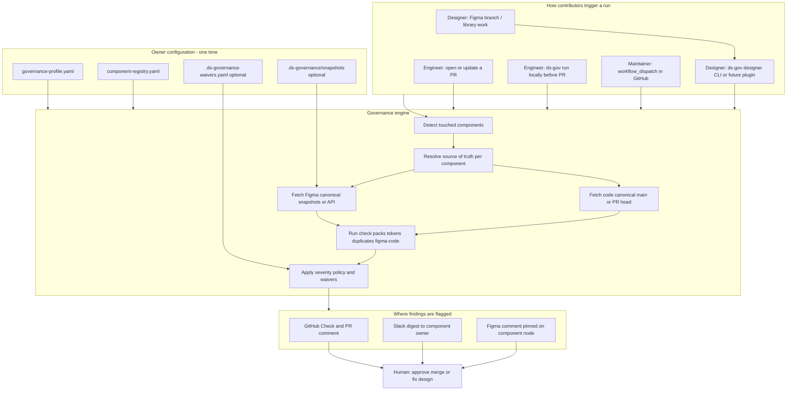

# Design System Governance Agent

Automated governance for design system contributions — from **engineer pull requests** and **designer Figma work**. The agent cross-checks token consistency, surfaces duplicate components, compares design and code canonicals, and **flags** issues via GitHub, Slack, and pinned Figma comments so manual review focuses on judgment, not lint hunting.

---

## Pipeline overview

Contributors enter from **design (Figma)** or **engineering (code)**. Both paths run the **same governance engine**, produce the **same finding IDs**, and route to the channels your owners configure.



**Verdict flow:** `block` findings can fail CI (configurable). `warn` surfaces in PR and Slack. `info` is usually report-only. Designers typically see **Figma comments** first; engineers see **GitHub annotations** first.

For **agents**, the same stages are defined in [`.cursor/skills/design-system-governance/SKILL.md`](.cursor/skills/design-system-governance/SKILL.md) with a **drift checklist at each stage** (token, design–code, duplicate, consumer, API, docs, regression vs pre-existing).

---

## Quick start (try the repo)

```bash
npm ci
npm run build
npm run test:fixtures
```

The fixture run scans `fixtures/sample-contribution` and should **fail** with:

- **Block** — hardcoded color `#2563EB` in sample `Button`
- **Warn** — Figma vs code snapshot mismatch on `radius` (see `.ds-governance/snapshots/`)

---

## Configuration (design system owners)

Owners set policy once. Contributors do **not** edit these files for day-to-day work unless they are adding a **new component** to the registry.

### Step 1 — Copy example configs

```bash
cp governance-profile.example.yaml governance-profile.yaml
cp component-registry.example.yaml component-registry.yaml
# optional
cp .ds-governance-waivers.example.yaml .ds-governance-waivers.yaml
```

| File | What it controls |
|------|------------------|
| [`governance-profile.yaml`](governance-profile.example.yaml) | Source-of-truth mode, token rules, severity per category, GitHub / Slack / Figma flagging |
| [`component-registry.yaml`](component-registry.example.yaml) | Every governed component: code paths, Figma file + node id, owners, check packs |
| [`.ds-governance-waivers.yaml`](.ds-governance-waivers.example.yaml) | Time-boxed exceptions so known debt does not block merges |
| `.ds-governance/snapshots/{Component}.figma.json` + `.code.json` | Canonical design/code fingerprints until live Figma API fetch is enabled |

Point CI at your files by renaming the examples **or** setting `GOVERNANCE_PROFILE` and `COMPONENT_REGISTRY` in [`.github/workflows/design-system-governance.yml`](.github/workflows/design-system-governance.yml).

### Step 2 — Source of truth (`governance-profile.yaml`)

```yaml
defaults:
  source_of_truth:
    mode: dual_compare    # figma | code | dual_compare
    on_conflict: flag_owner
    code:
      ref: main
    figma:
      enabled: false      # set true when FIGMA_ACCESS_TOKEN is configured
```

| Mode | Use when |
|------|----------|
| `code` | Released tokens and APIs in the repo are authoritative |
| `figma` | Design library leads; code is expected to catch up |
| `dual_compare` | Flag mismatches between design and shipped code (recommended) |

Per-component overrides live under `components.<Name>.source_of_truth` in the registry.

### Step 3 — Register components (`component-registry.yaml`)

Each component needs enough metadata for detection, ownership, and Figma pins:

```yaml
components:
  Button:
    kind: primitive
    checks: default_primitive
    owners:
      slack_channel: "#ds-components"
      github: "@ds-button-owners"
    source_of_truth:
      mode: dual_compare
      code:
        paths:
          - "packages/button/**"
      figma:
        file_key: "YOUR_FIGMA_FILE_KEY"
        component_set_node_id: "123:456"
```

- **`code.paths`** — globs used to detect that a PR touches this component.
- **`figma.*`** — where to pin comments when `figma_code_mismatch` (or similar) fires.
- **`check_packs`** — which checks run (`tokens`, `duplicates`, `figma_code`, …); see `check_packs` at the bottom of the example registry.

### Step 4 — Severity and flagging (`governance-profile.yaml`)

```yaml
severity_policy:
  token_consistency: block
  figma_code_mismatch: warn
  duplicate_candidate: warn

flagging:
  github:
    fail_on: [block]
  slack:
    enabled: true
    webhook_env: SLACK_WEBHOOK_URL
    on: [block, warn]
  figma_comments:
    enabled: true
    token_env: FIGMA_ACCESS_TOKEN
    on_severity: [block, warn]
    on_categories:
      - figma_code_mismatch
```

### Step 5 — GitHub Actions secrets (optional)

| Secret | Purpose |
|--------|---------|
| `SLACK_WEBHOOK_URL` | Post digest to team channel |
| `FIGMA_ACCESS_TOKEN` | Pin comments ([`file_comments:write`](https://developers.figma.com/docs/rest-api/comments-endpoints/)) |

---

## How to contribute

Governance runs **automatically** when you contribute through the normal design or engineering workflow. You do not need a separate “governance PR” unless you are changing policy or registering a new component.

### Designers (contribution through Figma)

1. **Work in the design system library** (branch or file your team uses for DS work).
2. **Use variables / semantic tokens** on the component — avoid raw hex on library components when your policy disallows it.
3. **Before handoff or publish**, run a governance check (today: CLI; later: Figma plugin calling the same command):

   ```bash
   export FIGMA_ACCESS_TOKEN=...   # only if Figma comments are enabled

   npm run ds-gov -- designer \
     -p governance-profile.yaml \
     -r component-registry.yaml \
     -c Button \
     --figma-file-key YOUR_FIGMA_FILE_KEY \
     --figma-comments
   ```

4. **Read feedback on the canvas** — discrepancies can appear as **pinned Figma comments** on the component node (when enabled).
5. **Fix or waive** — align variables with code canonical, or ask an owner for a time-boxed waiver in `.ds-governance-waivers.yaml`.
6. **Hand off to engineering** — share the Figma branch URL and note that governance was run (finding IDs are stable for the same issues in the eng PR).

**Adding a new component in Figma:** ask a maintainer to add an entry to `component-registry.yaml` (or open a small PR with `file_key`, `component_set_node_id`, and `designer_owners`).

### Engineers (contribution through code)

1. **Branch from `main`**, change the component or tokens under paths listed in the registry (e.g. `packages/button/**`).
2. **Use design tokens** — no raw colors if `tokens.allow_raw_values` is false in the profile.
3. **Open a pull request** — the [Design System Governance](.github/workflows/design-system-governance.yml) workflow runs on push to the PR.
4. **Read the PR comment** titled **Design System Governance** and fix **block** items (annotations point to file and line).
5. **Optional — run locally before pushing:**

   ```bash
   npm run ds-gov -- run \
     -p governance-profile.yaml \
     -r component-registry.yaml \
     --head .
   ```

6. **Request review** from code owners; component owners may be notified on Slack for block/warn findings.

**Adding a new component in code:** add the package paths and Figma linkage in `component-registry.yaml` in the same PR (or a preceding PR) so detection and ownership work on the first real change.

### Maintainers (policy and registry)

| Change | Who | Where |
|--------|-----|--------|
| Severity, Slack, Figma comment policy | DS lead | `governance-profile.yaml` |
| New component, owners, Figma node | Component owner / DS lead | `component-registry.yaml` |
| Approved exception | Owner | `.ds-governance-waivers.yaml` |
| Update design/code canonical | DS ops | `.ds-governance/snapshots/` or future Figma/code export job |

Manual full-repo audit:

```bash
# GitHub → Actions → Design System Governance → Run workflow
# optional input: component id
```

---

## What gets checked (all components)

The same check packs apply to every registered component; only registry paths and Figma nodes differ.

| Check | Typical severity | Contributor sees |
|--------|------------------|-------------------|
| Token consistency (raw colors, etc.) | `block` | GitHub line annotation |
| Duplicate / overlap heuristics | `warn` | PR comment + Slack |
| Figma ↔ code snapshot mismatch | `warn` | Figma comment + PR comment |
| Waived rules | downgraded / hidden | Note in report |

Finding shape is defined in [`schemas/finding.schema.json`](schemas/finding.schema.json).

---

## CLI reference

| Command | Audience | When |
|---------|----------|------|
| `ds-gov run` | Engineers | PR head or local folder |
| `ds-gov designer` | Designers | Figma-linked component, no PR |

```bash
npm run ds-gov -- run -p governance-profile.yaml -r component-registry.yaml --head .
npm run ds-gov -- run ... --slack --figma-comments --pr-url https://github.com/org/repo/pull/1
```

---

## Agent skill (pipeline + drift per stage)

Cursor agents should follow the same pipeline as CI and **audit drift at every stage** (intake, SoT, canonicals, each check pack, flagging, handoff).

| Resource | Purpose |
|----------|---------|
| [`.cursor/skills/design-system-governance/SKILL.md`](.cursor/skills/design-system-governance/SKILL.md) | Step-by-step pipeline (stages 0–8) with checklists |
| [`pipeline-and-drift.md`](.cursor/skills/design-system-governance/pipeline-and-drift.md) | Drift taxonomy and per-check matrix |

Invoke in chat by referencing **design-system-governance** when reviewing contributions or drift.

## Project layout

```
src/
  checks/          # token, duplicate, figma-code
  pipeline/        # detect components, waivers, run
  reporters/       # console, github, slack, figma
  cli.ts           # ds-gov run | designer
.github/workflows/design-system-governance.yml
.cursor/skills/design-system-governance/
  SKILL.md         # pipeline + per-stage drift checks
  pipeline-and-drift.md
```

---

## Roadmap

- [ ] Live Figma Variables fetch (branch-aware)
- [ ] Consumer-repo drift on a schedule
- [ ] Figma plugin wrapper for `ds-gov designer`
- [ ] Breaking API diff vs `git merge-base`

## License

MIT (add your org license as needed)
